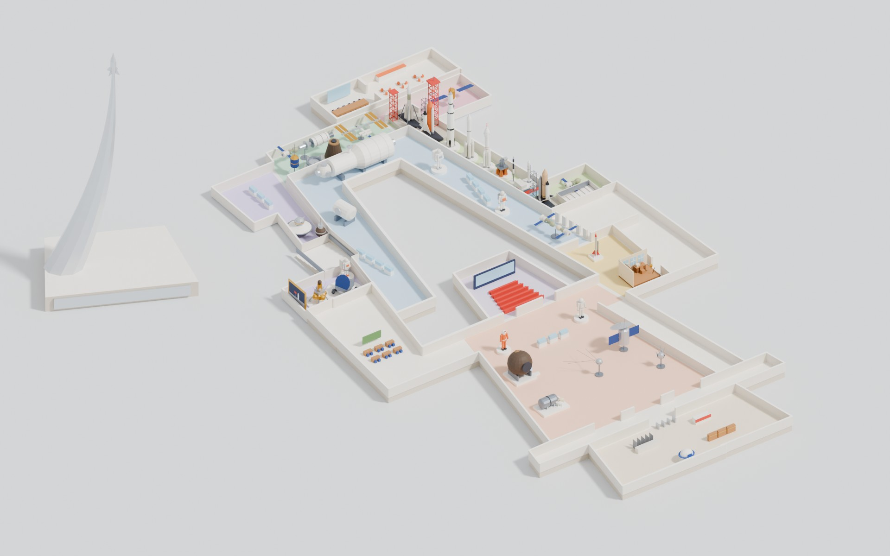

# Карта Музея космонавтики

Концепт: изометрическая 3D-карта Музея космонавтики (Москва, ВДНХ) в low-poly. Оба этажа собраны в одном пространстве, на карте 36 экспонатов, есть экскурсия с маскотами Белкой и Стрелкой. Стиль и подход такие же, как у «Ромашковой долины» в корне репозитория.



## Структура

| Папка | Что внутри |
|---|---|
| `site/` | Сайт: `index.html` (three.js 0.160, всё в одном файле) и модель `kosmo_map.json` (glTF со встроенными данными). `kosmo_map.glb` — та же модель в бинарном виде для Blender, Figma и других программ. |
| `blender/` | `kosmo_map.blend` — общий файл. Сцена «Карта»: оба этажа, экспонаты, зоны, монумент, маскоты, изометрическая камера `Iso`. Сцена «Библиотека экспонатов»: все модели по отдельности. `exhibits/` — каждый экспонат и каждый маскот отдельным .blend. `meta.json` — координаты и размеры экспонатов. |
| `scripts/` | Python-скрипты, из которых собирается вся сцена (подробнее ниже). |
| `data/` | `plan.json` — контуры этажей, стен и залов с официальной карты kosmo-museum.ru/map. `plan_one.json` — единый план: этажи в реальном положении, лестницы, вырезы. |
| `renders/` | Общий план, крупные планы залов, контактный лист экспонатов, маскоты. |
| `research/` | Сводка по музею (залы, 38 экспонатов с координатами, учётные номера) и скриншоты официальной карты. |

## Как посмотреть сайт

Сборка не нужна. Откройте `site/index.html` через любой локальный сервер, например `python3 -m http.server` в папке `site`, и зайдите на `http://localhost:8000`. Если для репозитория включены GitHub Pages, сайт доступен по адресу `…/romashka/kosmo-museum-map/site/`.

На сайте:
- карту можно двигать и приближать, вращения нет (фиксированная изометрия: азимут −35°, наклон 36°);
- клик по залу или экспонату — перелёт к нему, у экспоната открывается карточка с учётным номером;
- переключатель этажей: выбранный этаж остаётся в цвете, второй становится полупрозрачным;
- «Экскурсия с Белкой и Стрелкой»: 15 остановок, собаки перебегают от экспоната к экспонату и по очереди рассказывают. Ссылка с `#tour` в конце адреса сразу запускает экскурсию, `#ex12` открывает экспонат с id 12.

## Как устроена модель

- **Планировка.** Контуры взяты из SVG-планов сайта музея, масштаб 1 px = 0,1 м. Нижний этаж огибает «А»-зал снаружи и стоит на 1 м ниже. Этажи пересекаются только в двух крыльях, там стоят лестницы. Где нижние залы уходят под верхний пол, верхний пол вырезан.
- **Экспонаты.** Low-poly, плоские цвета, без текстур, около 27 тыс. треугольников на всё. Модели сделаны в реальных размерах, а на карте увеличены в 1,2–2,2 раза, чтобы читались.
- **Маскоты.** Белка — белая, в оранжевом жилете; Стрелка — кремовая, в синем. Дизайн собственный, без сходства с персонажами мультфильма «Белка и Стрелка. Звёздные собаки».
- **Монумент «Покорителям космоса»** уменьшен и поставлен рядом со зданием как ориентир.

## Как пересобрать

Нужен Python с модулем `bpy` 5.2 (`pip install bpy`) или Blender 5.2, а для работы с планом ещё `shapely`, `svgpathtools` и `matplotlib`.

```
cd scripts
python3 unify_plan.py      # только если менялись контуры: пересобирает data/plan_one.json
python3 build_map.py       # собирает blender/kosmo_map.blend, blender/exhibits/*.blend и blender/meta.json
python3 export_glb.py      # экспортирует site/kosmo_map.glb
python3 glb_to_json.py     # переводит GLB в site/kosmo_map.json, который грузит сайт
```

JSON-версия нужна, потому что хостинг артефактов claude.ai не отдаёт .glb. Если сайт живёт только на GitHub Pages, можно поменять в `index.html` имя файла на `kosmo_map.glb` и обойтись без этого шага.

С Blender вместо `bpy`: `blender -b -P build_map.py`.

### Где что править

- **Расстановка, масштаб и поворот экспонатов** — таблица `EXHIBITS` в конце `scripts/exhibits.py`. Координаты указаны в пикселях официальной SVG-карты.
- **Модели экспонатов** — функции `ex_*` в `scripts/exhibits.py`. Примитивы и палитра — в `scripts/klib.py`.
- **Маскоты** — `ms_dog`, `ms_belka`, `ms_strelka` и таблица `MASCOTS` в `scripts/exhibits.py`.
- **Тексты экскурсии** — массив `TOUR` в `site/index.html`.
- **Описания и учётные номера** — массив `EX` в `site/index.html`.

## Что можно доделать

- Сверить пропорции моделей с фото из карточек музея: модели собраны по описаниям.
- Добавить зал «История и культура космической эпохи» (на официальной карте его нет) и экспонаты из топ-15 без точки на карте: кардиограмму Гагарина, скафандр Коллинза, биопринтер «Орган.Авт», ферму «Софора».
- Анимировать маскотов в Blender (походка, жесты) и озвучить экскурсию.
- Сделать пролёт по карте для ролика.
